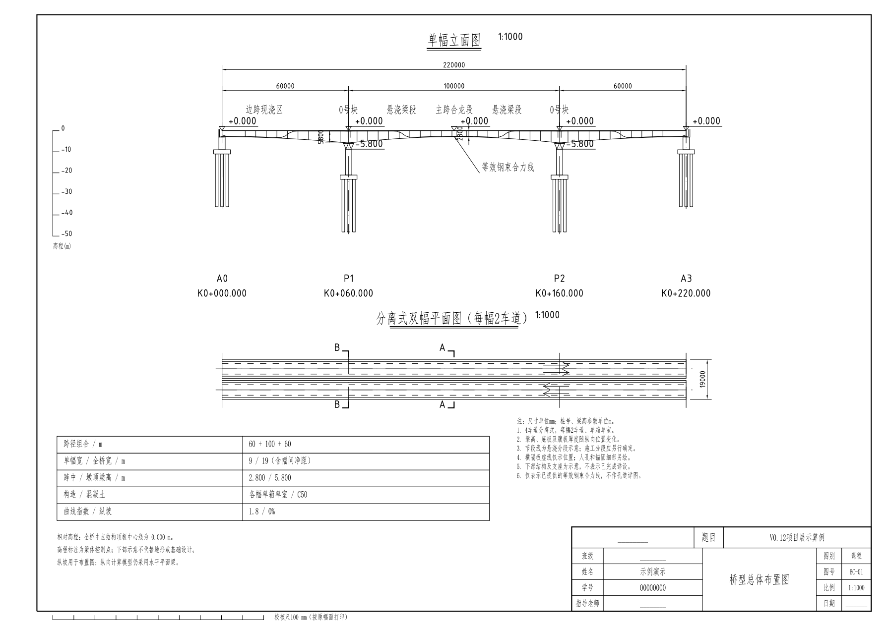
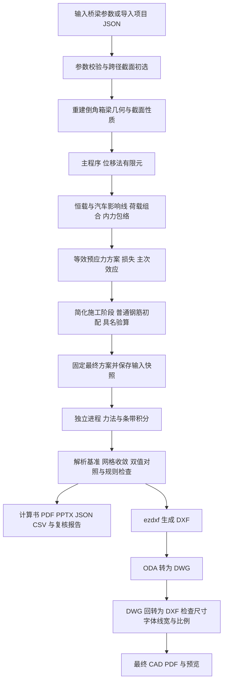
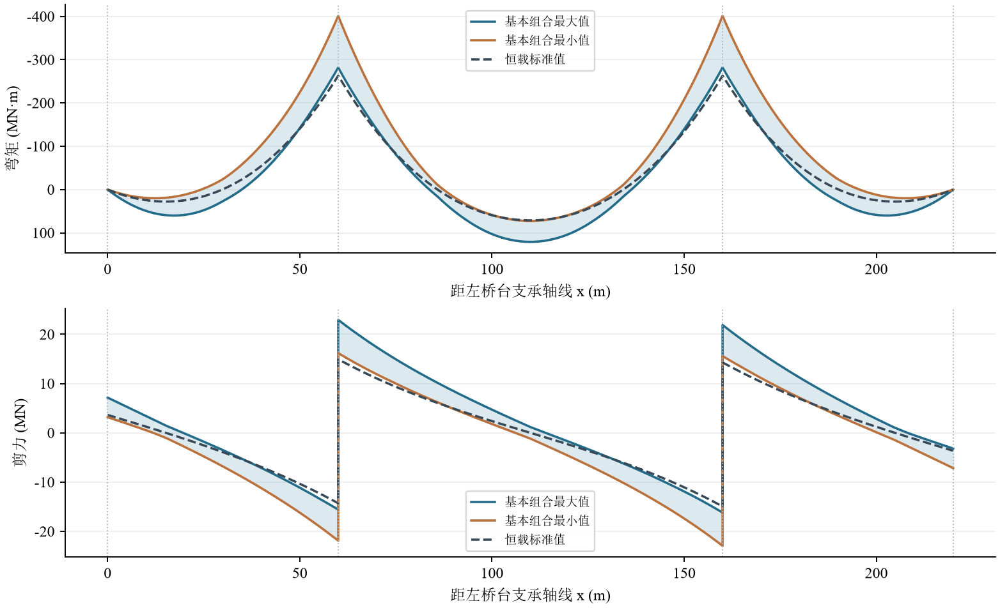
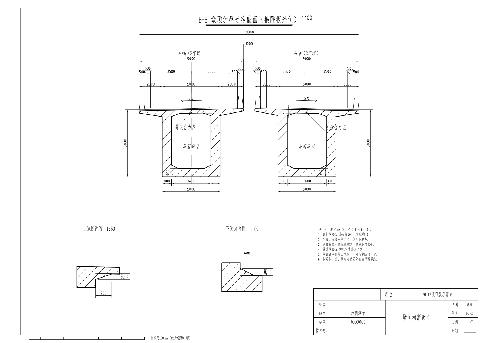

# 连续箱梁桥课程设计生成器

**Bridge Generator Homework · V0.12**

从桥梁参数出发，自动完成三跨变截面连续箱梁的课程范围计算、独立交叉验证、计算书、答辩汇报和 CAD 图纸。项目用于桥梁工程课程设计与计算方法学习。

支持 **50～150 m 主跨、全桥 2 / 4 / 6 车道、自动或手动边跨、带顶板加腋与底板倒角的单箱单室截面**。计算与出图在本机执行，不要求安装 AutoCAD，也不要求调用在线 AI 或 MCP 服务。生成 DWG 时调用用户安装的 **ODA File Converter**。

[下载 V0.12 程序](https://github.com/Jinyi5077/Bridge-Generator-Homework/releases/tag/v0.12.0) · [使用说明](src/使用说明.md) · [设计思路与算法](docs/design-and-algorithms.md) · [成果文件与 ODA](docs/outputs-and-oda.md) · [真实运行算例](samples/60-100-60m-4lanes/README.md) · [本地运行记录](docs/local-run.md)

Release 已发布原始 Windows 程序包。GitHub 自动将下载文件名简化为 `BridgeGenerator_V0.12_.zip`；文件大小为 101181598 bytes，SHA-256 与上传前的原始 ZIP 完全一致，未重新编译或打包。完整校验值见[运行与发布记录](docs/local-run.md)。



## 这个程序解决什么问题

课程设计需要反复调整跨径、车道、截面与荷载，并把计算结果整理为计算书、汇报和图纸。本项目将这些工作连接到同一套参数与结果数据上：截面几何用于计算面积和惯性矩，也用于绘制箱梁轮廓；内力、预应力和验算结果再用于生成表格、图表与汇报。

每次运行保存输入来源、规范配置、工况组合、公式记录、结果坐标和文件哈希。计算路径可以从成果追溯回输入，而不只给出一个“通过”的结论。

V0.12 增加了第二套独立计算内核。主程序使用位移法有限元，复核程序使用力法和虚功积分，在另一个进程中重算。两套程序只共享物理输入及最终钢束、钢筋方案，不共享已计算的截面性质、内力、应力或承载力。

## 支持的桥型与参数

| 项目 | V0.12 范围或默认规则 |
| --- | --- |
| 桥型 | 三跨预应力混凝土变截面连续箱梁，纵向平面梁模型 |
| 主跨 | 50～150 m |
| 边跨 | 自动按主跨比例匹配，默认 0.60；允许分别手动输入，支持不对称三跨 |
| 2 车道 | 单幅双向，单箱单室 |
| 4 车道 | 分离两幅，每幅 2 车道、单箱单室 |
| 6 车道 | 分离两幅，每幅 3 车道、单箱单室 |
| 纵向梁高 | 按跨径匹配初值，默认采用指数 1.8 的幂函数变化 |
| 横断面 | 顶板悬臂、顶板加腋、腹板、变厚底板及箱室倒角 |
| 荷载 | 一期自重、铺装、护栏及其他恒载、公路Ⅰ级汽车荷载 |
| 参数编辑 | 普通表单、高级 JSON、项目保存和重新导入 |
| 数据单位 | 主程序 kN / m，独立内核 N / mm / MPa，比较前统一单位 |

参数匹配给出的是初选尺寸。改变跨径和车道数后，仍须按当前方案重新计算，不能把自动匹配理解为自动满足全部验算。

## 从输入到成果的流程



## 主要计算方法

### 几何与纵向有限元

沿桥长生成外轮廓和带倒角的箱室轮廓。主引擎以多边形积分计算截面面积、形心、惯性矩和截面模量，空腔面积从实体轮廓中扣除。

纵向计算采用 Euler–Bernoulli 梁，每节点有竖向位移与转角两个自由度。支点约束竖向位移，连续梁转角保持连续。变截面刚度和自重沿单元用四点 Gauss 积分，默认分析网格为 0.5 m。计算截面保留剪力的左右侧值，避免支点跳跃被平均。

### 恒载、活载与组合

自重随截面面积变化；铺装、护栏等二期恒载根据实际宽度和输入参数计算。汽车作用通过单位荷载影响线寻找均布荷载的不利区间与集中荷载的不利位置。按每幅实际启用车道枚举车道组合，再形成基本、标准、频遇和准永久组合。

基频由刚度与一致质量矩阵的特征值计算，冲击系数依频率确定。频遇和准永久汽车作用不含冲击，正常使用挠度另按频遇汽车荷载、换算截面刚度与长期系数计算。

### 预应力、施工与验算

按截面需求生成分区等效钢束组，计算摩阻、锚缩、弹性压缩及课程参数化的收缩、徐变和松弛损失。转角由钢束实际深度求导，连续体系次效应用初始弯矩荷载求解。

施工阶段覆盖 P1 / P2 双主墩静定悬臂的节段荷载、挂篮作用、已激活钢束、根部内力和应力。普通纵向钢筋与箍筋为程序初配。课程范围具名验算包含抗弯、抗剪、抗裂、使用阶段压应力、挠度和施工阶段压应力六类。

抗剪对正负剪力分支分别计入有符号钢束竖向分量；零承载力不能被报告为零利用率。计算过程和简化条件详见[算法说明](docs/design-and-algorithms.md)。

## 内置独立复核怎样工作

| 项目 | 主程序 A | 独立程序 B |
| --- | --- | --- |
| 截面性质 | 外轮廓减空腔的多边形积分 | 独立重建轮廓，水平条带积分 |
| 连续梁 | 位移法有限元 | 释放两个内支点，力法解冗余支反力 |
| 位移与次效应 | 形函数、刚度矩阵与等效荷载 | 虚功积分与支点协调方程 |
| 基频 | 刚度和质量矩阵特征值 | 柔度 Green 矩阵与质量积分特征值 |
| 运行 | 主计算进程 | 单独子进程，并检查未载入主引擎模块 |
| 输入 | 项目参数并自动生成方案 | 输入参数及固定的最终钢束、钢筋方案 |

独立程序每次先运行六组解析基准，再执行逐级加密计算。比较采用绝对容差加相对容差，近零值使用绝对容差；缺项、形状不符、非有限值、超时和快照不符都不能判为通过。

计算完成后自动复核，也可点击“一键重新复核本次方案”。重新复核固定当前方案，不重新选束、配筋或绘图，每次保留新的编号与报告。

**两套程序一致，表示已覆盖模型的结果在容差内一致，不代表完整工程设计复核，也不能排除共有的规范理解问题。**

## 一次运行可以得到什么

| 成果 | 内容 |
| --- | --- |
| DOCX / PDF 计算书 | 已计算章节、公式、中间值、结果、验算及独立复核结论 |
| PPTX 汇报 | 23 页；原生可编辑图表、表格、嵌入工作簿、来源备注 |
| DXF / DWG | 总体布置、跨中横断面、墩顶横断面三张图；原生尺寸标注与倒角详图 |
| CAD PDF / PNG | 从实际 CAD 布局生成的图纸及预览；DWG 成功时采用回转文件渲染 |
| JSON / CSV | 完整设计结果、工况组合、计算数据、输入来源、公式与追溯表 |
| 离线复核报告 | A / B 双值、控制坐标、容差、收敛记录、规则与覆盖状态 |
| 制图检查与清单 | 尺寸、图层、字体、打印比例、转换检查、文件字节数及 SHA-256 |

计算书中文字体设置为宋体，英文字体设置为 Times New Roman，公式以 `Equation.DSMT4` MathType OLE 对象保存。CAD 采用独立工程字体样式，中文仿宋与数字 ISO 样式；它们与计算书字体要求不同。





## 使用方法

### Windows 程序包

1. 在 [V0.12 下载页](https://github.com/Jinyi5077/Bridge-Generator-Homework/releases/tag/v0.12.0)下载并完整解压程序包。
2. 双击 `BridgeGenerator_V0.12.exe`，使用自动打开的本地浏览器界面。
3. 填写绘图人、学号、跨径、车道和其他参数。
4. 点击“计算并生成成果”，等待主计算、独立复核和成果导出结束。
5. 在结果卡查看复核状态、文件列表或打开成果文件夹。

EXE 已包含 Python 与计算库，使用程序包不需要另装 Python、商业结构计算软件或在线 AI 服务。编辑 DOCX / PPTX、打开 DWG 时使用相应文档或 CAD 阅读器。

需要 DWG 时，请从 [ODA 官方页面](https://www.opendesign.com/guestfiles/oda_file_converter)安装 ODA File Converter。仓库和程序包不包含 ODA 安装程序，不要求安装 AutoCAD。[ODA 配置和调用说明](docs/outputs-and-oda.md#oda-file-converter)。

### 源码运行

```powershell
cd src
python -m venv .venv
.\.venv\Scripts\Activate.ps1
pip install -r requirements.txt
python app.py
```

本次已验证的打包运行环境为 Windows x64、Python 3.12。其他平台可从源码尝试，但本仓库不把它们列为已验证平台。

### 命令行生成与重新复核

```powershell
# 使用程序包的示例输入，输出目录必须为空
.\BridgeGenerator_V0.12.exe --config .\examples\default.json --output .\results\example

# 跳过 DWG 转换，仍生成其他成果
.\BridgeGenerator_V0.12.exe --config .\examples\default.json --output .\results\without_dwg --no-dwg

# 仅重新复核已经保存的固定方案
.\BridgeGenerator_V0.12.exe --recheck .\results\example\设计结果.json --output .\results\recheck
```

源码运行时，将 EXE 命令替换为 `python app.py`。命令行普通生成的退出码主要反映 DWG 导出，**不能用退出码 0 替代具名验算和交叉验证状态**；应检查 `设计结果.json`。

## 结果状态的含义

| 状态 | 含义 |
| --- | --- |
| `COURSE_SCOPE_COMPLETE` | 课程范围六类具名验算通过 |
| `COURSE_SCOPE_FAILED` | 计算完成，至少一类具名验算未通过，需调整方案 |
| `CONSISTENT_WITHIN_SCOPE` | 独立复核的已覆盖项目一致，固定方案通过其验算 |
| `NEEDS_REVIEW` | 存在数值偏差、规则问题或固定方案未满足限值 |
| `ERROR` | 独立计算未完成；不得理解为通过 |
| `PARTIAL` | 规则或验证范围仅部分覆盖，需结合范围说明阅读 |

默认 120 m 和 150 m 六车道初选方案在有符号钢束抗剪计算中存在未通过项，程序如实保留失败结论。这不表示所有支持参数都会自动得到可用设计。

## 算例与验证证据

本仓库的展示算例于 **2026-10-10** 在本机从原始 V0.12 程序包运行，桥型为 **60＋100＋60 m、四车道、分离两幅、每幅单箱单室**。示例姓名和学号为演示值。

关键结果、运行状态、选中文件及其哈希见[算例目录](samples/60-100-60m-4lanes/README.md)和[本地运行记录](docs/local-run.md)。数据来自该次 `设计结果.json`，不从其他算例补填。

V0.12 发行前的回归记录包含 59 项测试，以及 13 组跨径、车道、非对称边跨、材料和预应力类别的双程序对照；这些是 **2026-10-06 的发行验证记录**，与本次运行分开保存。[历史发行验证](src/质量检查/V0.12完整回归.log)。

## 仓库目录

```text
README.md                         项目首页
docs/
  design-and-algorithms.md         设计思路、方程与两套算法
  outputs-and-oda.md               成果说明、工程制图设置与 ODA
  local-run.md                     本次实际运行与检查记录
samples/60-100-60m-4lanes/          遴选的实际计算成果
src/                              V0.12 对应源码、测试、示例及发行记录
```

完整 Windows 程序包放在 GitHub Release，源码与代表性成果放在仓库中。没有上传本机历史运行目录、临时 PPT、公式预览缓存、ODA 二进制或用户此前提供的工程原图和规范全文。

## 使用范围与后续方向

当前模型覆盖课程纵向平面梁、等效预应力和简化施工阶段。横向桥面板、横隔板、空间扭转、剪力滞、畸变、真实分束与锚固区、局部承压、完整节段激活和合龙历史、下部结构、温度、沉降、风、地震及偶然作用尚未完成。

后续可逐步增加人工可核对的小算例、完整施工历史、预应力分束细化和更多范围明确的独立验证。本版持续保留覆盖限制，避免将课程自动化成果误写为完整施工图设计。

## 参考与依赖

- 算法采用项目内的 [JTG D60—2015 / JTG 3362—2018 配置](src/bridgegen/code_profiles.py)。官方来源见[详细说明](docs/design-and-algorithms.md#资料来源与规则配置)；这里只声明本版配置，不宣称涵盖所有现行条文。
- [NumPy](https://numpy.org/doc/) / [SciPy](https://docs.scipy.org/doc/scipy/)：数组、线性方程与特征值计算。
- [ezdxf](https://ezdxf.readthedocs.io/)：DXF 构造与 CAD 语义检查；[其 ODA 支持说明](https://ezdxf.readthedocs.io/en/stable/addons/odafc.html)说明了使用外部转换器的路径。
- [ODA File Converter](https://www.opendesign.com/guestfiles/oda_file_converter)：通过命令行完成 DXF / DWG 转换，按 ODA 自身条款单独安装。
- [python-docx](https://python-docx.readthedocs.io/) / [python-pptx](https://python-pptx.readthedocs.io/) / [ReportLab](https://docs.reportlab.com/) / [Matplotlib](https://matplotlib.org/stable/) / [pypdfium2](https://pypdfium2.readthedocs.io/)：文档、汇报、图表与 PDF 处理。

各依赖和字体按各自许可使用。仓库未附带商业字体文件，也未为 ODA 授予再分发许可。项目尚未添加独立开源许可证。
