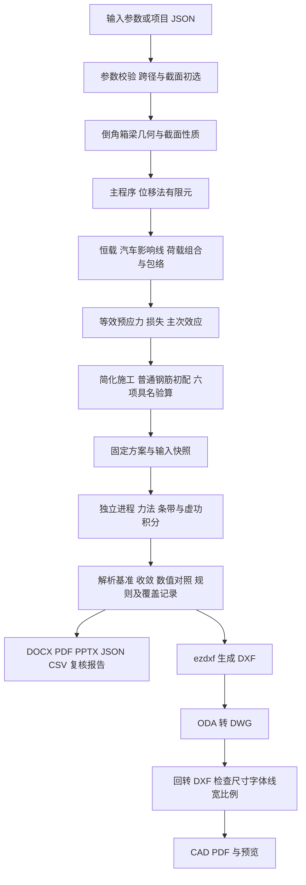

# 连续箱梁桥课程设计生成器

**Bridge Generator Homework · V0.13**

从桥梁参数出发，自动完成三跨变截面连续箱梁的课程范围计算、独立交叉验证、计算书、答辩汇报和 CAD 图纸。项目用于桥梁工程课程设计与计算方法学习。

支持 **50～220 m 主跨、全桥 2 / 3 / 4 / 6 车道、自动或手动边跨、带顶板加腋与底板倒角的单箱单室截面**。三车道为单幅；四、六车道为分离两幅。计算与出图在本机执行，不要求安装 AutoCAD、在线 AI、MCP 或商业结构计算软件；DWG 导出调用用户安装的 ODA File Converter。

[V0.13 下载](https://github.com/Jinyi5077/Bridge-Generator-Homework/releases/tag/v0.13.0) · [使用说明](src/使用说明.md) · [本版修改](docs/v0.13-changes.md) · [设计与算法](docs/design-and-algorithms.md) · [成果与 ODA](docs/outputs-and-oda.md) · [220 m 三车道算例](samples/132-220-132m-3lanes/README.md) · [运行记录](docs/v0.13-local-run.md)

**220 m 展示算例的抗弯、抗剪、抗裂和使用阶段压应力未通过。** 两套程序 364 项数值对照一致、六项验算判断一致，表示已覆盖模型得到一致计算，不能将初选尺寸视为已合格的设计。状态、限值与控制数据全部随成果保存。


## 设计思路

截面几何同时用于面积、形心、惯性矩、自重和图纸；计算结果同时用于计算书、汇报、图表及追溯数据。输入来源、规范配置、工况组合、公式记录、控制坐标和文件哈希随每次运行保存，减少手工转抄差异。

主程序采用位移法有限元；内置独立程序在隔离子进程中采用力法和虚功积分。两者只共享物理输入和最终钢束、钢筋方案，不共享已计算的截面性质、内力、应力或承载力。

## 支持的桥型与参数

| 项目 | V0.13 范围或默认规则 |
| --- | --- |
| 桥型 | 三跨预应力混凝土变截面连续箱梁，纵向平面梁模型 |
| 主跨 | 50～220 m |
| 边跨 | 自动比例 0.50～0.80，默认 0.60；允许分别手动输入和不对称三跨，手动上限 176 m |
| 2 车道 | 单幅双向，单箱单室 |
| 3 车道 | 单幅同向，单箱单室；默认顶板宽 12.50 m，可编辑 |
| 4 车道 | 分离两幅，每幅 2 车道、单箱单室 |
| 6 车道 | 分离两幅，每幅 3 车道、单箱单室 |
| 纵向梁高 | 按跨径匹配可编辑初值，默认指数 1.8 的幂函数变化 |
| 横断面 | 顶板悬臂、加腋、腹板、变厚底板及箱室倒角 |
| 荷载 | 一期自重、铺装、护栏及其他恒载、公路Ⅰ级汽车荷载 |
| 长跨活载 | 最大单跨不大于 150 m 取 1.00，超过 150 m 至 220 m 取 0.97 |
| 参数编辑 | 表单、高级 JSON、保存 / 导入项目；兼容旧浏览器项目记录 |
| 数据单位 | 主程序 kN / m，独立内核 N / mm / MPa，比较前统一单位 |

改变跨径和车道后，自动匹配给出的是截面与配筋初值，仍须重新计算并查看验算结论。

## 从输入到成果的流程



## 主要计算方法

### 几何与纵向求解

沿桥长建立外轮廓和带倒角的空腔轮廓，多边形积分计算截面性质。底板及腹板厚度随纵向位置插值，梁高默认采用指数 1.8 的幂函数，不能称为严格二次抛物线。

Euler–Bernoulli 梁每节点有竖向位移和转角两个自由度，支点约束竖向位移，内支点保持转角连续。刚度、自重用四点 Gauss 积分，默认网格 0.5 m；剪力保留截面左右侧值。

### 恒载、活载与组合

自重按实际面积计算，铺装及护栏按实际单幅宽度计算。单位荷载影响线定位均布荷载的不利区间和集中荷载的不利位置，按每幅实际启用车道枚举组合，形成基本、标准、频遇和准永久组合。

三车道枚举 7 个非空子集；1 / 2 / 3 条启用车道分别取 1.20 / 1.00 / 0.78。V0.13 按 JTG D60—2015 表 4.3.1-6 加入纵向折减：使用最大单跨而非总桥长，150 m 本身不折减，150 m 以上至本版上限取 0.97。汽车弯矩、剪力、支反力、位移以及重新计算的使用挠度同步计入，恒载不乘该系数。

基频由刚度与一致质量矩阵的特征值确定，冲击随频率计算；频遇、准永久汽车作用不含冲击。正常使用挠度采用换算截面刚度及长期系数。

### 预应力、施工与验算

按截面需求初选分区等效钢束，计算摩阻、锚缩、弹性压缩，以及课程参数化的收缩、徐变与松弛损失。由钢束实际深度求转角，连续体系次效应通过初始弯矩荷载求解。

简化施工包括 P1 / P2 双主墩的静定悬臂节段、挂篮、已激活钢束、根部内力与应力。普通纵向钢筋及箍筋为初配。六项具名验算包括抗弯、抗剪、抗裂、使用阶段压应力、活载挠度及施工阶段压应力。抗剪分别处理正负剪力及有符号钢束竖向分量；零承载力不能报告为零利用率。[详细方程与实现](docs/design-and-algorithms.md)。

## 内置独立复核

| 项目 | 主程序 A | 独立程序 B |
| --- | --- | --- |
| 截面性质 | 外轮廓减空腔的多边形积分 | 独立重建轮廓，水平条带积分 |
| 连续梁 | 位移法有限元 | 释放两个内支点，力法求冗余支反力 |
| 位移、次效应 | 形函数、刚度矩阵、等效荷载 | 虚功积分与支点协调方程 |
| 基频 | 刚度与质量矩阵特征值 | 柔度 Green 矩阵与质量积分特征值 |
| 运行 | 主计算进程 | 独立子进程，检查未加载主引擎模块 |
| 输入 | 输入参数并自动初选方案 | 物理输入及固定的最终钢束、钢筋方案 |

独立程序先运行六组解析基准，再逐级加密计算。比较采用绝对容差加相对容差，近零值采用绝对容差；缺项、形状不符、非有限值、超时或快照不符不能判为通过。本版超时上限 600 s。

计算结束后自动复核，也可一键重新复核当前固定方案。重新复核不重新选束、配筋或绘图，每次保存新的编号与报告。**两套程序一致只说明已覆盖模型在容差内一致，不能排除共有规则理解问题，也不代表完整工程复核。**

## 成果文件

| 成果 | 内容 |
| --- | --- |
| DOCX / PDF | 已计算章节、公式、中间值、验算与独立复核结论 |
| PPTX | 23 页，可编辑图表和表格、嵌入数据工作簿、来源备注 |
| DXF / DWG | 总体布置、跨中横断面、墩顶横断面，原生尺寸和倒角详图 |
| CAD PDF / PNG | 实际 CAD 布局导出，DWG 成功时从回转文件渲染 |
| JSON / CSV | 输入来源、规范配置、荷载组合、完整设计数据和公式追溯 |
| 复核 HTML / JSON | A / B 双值、控制坐标、容差、收敛、规则和覆盖状态 |
| 制图检查 / 清单 | 字体、尺寸、图层线宽、线型、比例及文件 SHA-256 |

计算书使用宋体与 Times New Roman，公式为 `Equation.DSMT4` MathType OLE。CAD 使用中文仿宋及数字 ISO 工程样式，保留 A3 工程图框、分级线宽、剖面、中心线、隐线和打印比例。长跨墩顶窄尺寸标注错行显示；三车道箭头同向，两车道双向。[成果与 ODA 说明](docs/outputs-and-oda.md)。


## 使用方法

### Windows 程序包

1. 在 [V0.13 Release](https://github.com/Jinyi5077/Bridge-Generator-Homework/releases/tag/v0.13.0) 下载 `BridgeGenerator_V0.13_Windows.zip`，完整解压。
2. 双击 `BridgeGenerator_V0.13.exe`，在自动打开的本地浏览器界面填写绘图人、学号及参数。
3. 点击“计算并生成成果”，等待主计算、独立复核和导出完成，在结果卡检查具名验算及复核状态。

程序包已包含 Python 和计算库。需要 DWG 时，请单独安装 [ODA File Converter](https://www.opendesign.com/guestfiles/oda_file_converter)；程序包不含 ODA 安装文件。编辑文档或打开 DWG 使用相应阅读器。

### 源码运行

```powershell
cd src
python -m venv .venv
.\.venv\Scripts\Activate.ps1
pip install -r requirements.txt
python app.py
```

本版已验证 Windows x64、Python 3.12。其他平台未列为已验证平台。

### 命令行与重新复核

```powershell
# 输出目录使用新的空目录
.\BridgeGenerator_V0.13.exe --config .\examples\three_lane_220m.json --output .\results\three_lane_220m

# 跳过 DWG，保留其他成果
.\BridgeGenerator_V0.13.exe --config .\examples\default.json --output .\results\without_dwg --no-dwg

# 固定当前方案，单独重做独立复核
.\BridgeGenerator_V0.13.exe --recheck .\results\three_lane_220m\设计结果.json --output .\results\recheck
```

源码运行将 EXE 替换为 `python app.py`。生成退出码 0 不能代替设计验算与交叉验证状态，应检查 `设计结果.json`。

## 状态与验证证据

| 状态 | 含义 |
| --- | --- |
| `COURSE_SCOPE_COMPLETE` | 六类课程具名验算通过 |
| `COURSE_SCOPE_FAILED` | 计算完成，至少一类具名验算未满足限值 |
| `CONSISTENT_WITHIN_SCOPE` | 独立复核已覆盖项目一致，固定方案通过其验算 |
| `NEEDS_REVIEW` | 存在数值偏差、规则问题或方案未满足限值 |
| `ERROR` | 独立计算未完成，不得当作通过 |
| `PARTIAL` | 规则或验证覆盖仍有范围限制 |

2026-10-10 最终 EXE 的三车道 132＋220＋132 m 完整运行采用 0.5 m 网格：约 94.6 s、364 项数值比较 PASS、六项判断一致、3 张经 ODA 回转检查的 DWG、29 页 PDF 和 23 页 PPT。抗弯、抗剪、抗裂、使用压应力 FAIL；挠度及简化施工压应力 PASS。

DOCX 的 63 个 MathType OLE 与字体字段已核对；PDF 已检查全页缩览和代表页，未使用 Word 渲染 DOCX。代表文件保持原始字节，数据从本次计算结果读取。[算例](samples/132-220-132m-3lanes/README.md) · [实际检查记录](docs/v0.13-local-run.md)。

69 项唯一测试最终通过，其中完整运行保留 68 通过、1 项旧公式文字断言失败的日志；更新新增系数断言后单项复跑通过，CAD 调整后 4 项复跑通过。另有 9 组新增参数的 2 m 网格对照，涵盖 150 m 折减边界和 220 m 多车道。[回归汇总](src/质量检查/V0.13回归验收汇总.json)。

## 目录与历史

```text
README.md                         项目首页
docs/                             算法、ODA、版本修改及运行记录
samples/132-220-132m-3lanes/        V0.13 真实代表成果
samples/60-100-60m-4lanes/          V0.12 历史成果
src/                              V0.13 源码、测试、示例、文件校验与发行记录
```

完整程序包及原始源码 ZIP 放在 Release。主分支保存源码与代表成果；上传中间分段只在 `release-assets-v0.13` 发布分支。Windows 包 107577035 bytes、源码包 1236024 bytes，下载后的 SHA-256 可与[发布校验记录](docs/v0.13-local-run.md)核对。

[V0.12 历史 Release](https://github.com/Jinyi5077/Bridge-Generator-Homework/releases/tag/v0.12.0)、[四车道 100 m 算例](samples/60-100-60m-4lanes/README.md)及[旧版运行记录](docs/local-run.md)继续保留，不作为 V0.13 验证记录。

## 范围与依赖

模型限于课程纵向平面梁、等效预应力及简化施工阶段。空间扭转、剪力滞、畸变、横向桥面板、横隔板、锚固区和局部承压、完整节段激活 / 合龙 / 逐龄期继承、下部结构、温度、沉降、风、地震及偶然作用尚未完成。

- [规范配置](src/bridgegen/code_profiles.py)：JTG D60—2015 / JTG 3362—2018 本版采用的规则，未宣称涵盖所有条文。纵向折减据 [JTG D60—2015 官方 PDF](https://xxgk.mot.gov.cn/jigou/glj/202006/P020240327350422059754.pdf) 表 4.3.1-6。
- [NumPy](https://numpy.org/doc/) / [SciPy](https://docs.scipy.org/doc/scipy/)：数组、线性方程和特征值。
- [ezdxf](https://ezdxf.readthedocs.io/)：DXF 构造与语义检查；[ODA 支持文档](https://ezdxf.readthedocs.io/en/stable/addons/odafc.html)。
- [ODA File Converter](https://www.opendesign.com/guestfiles/oda_file_converter)：外部命令行转换，按其自身条款单独安装。
- [python-docx](https://python-docx.readthedocs.io/) / [python-pptx](https://python-pptx.readthedocs.io/) / [ReportLab](https://docs.reportlab.com/) / [Matplotlib](https://matplotlib.org/stable/) / [pypdfium2](https://pypdfium2.readthedocs.io/)：成果生成与处理。

各依赖及字体遵循各自许可。仓库不附带 ODA 安装程序或商业字体文件，亦不上传用户此前提供的工程原图与规范全文。项目尚未添加独立开源许可证。
