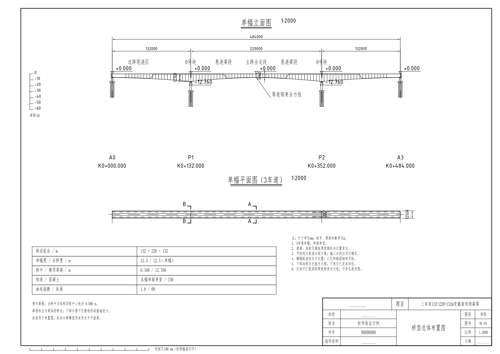
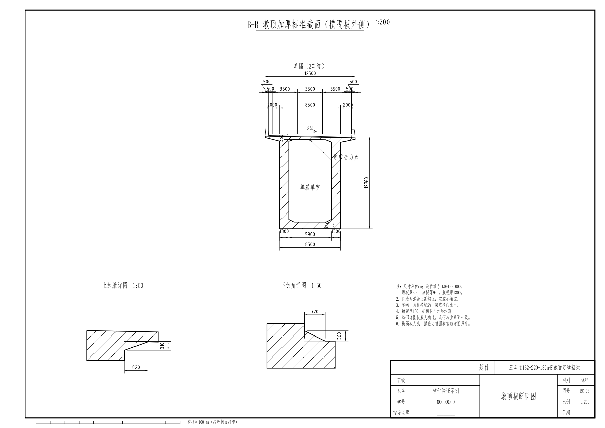
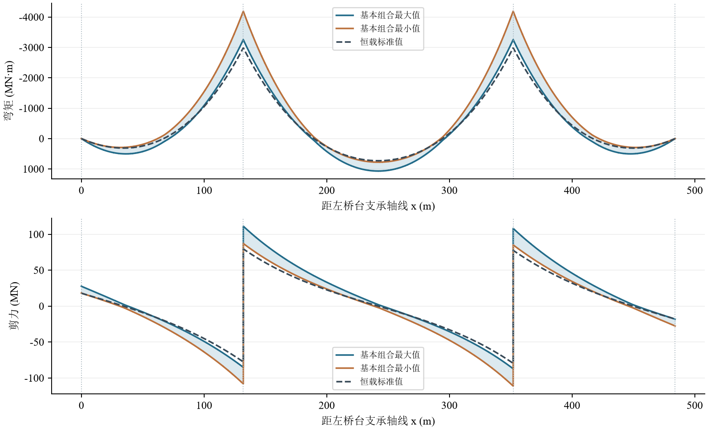

# V0.13 真实运行算例：132＋220＋132 m、三车道

[返回项目首页](../../README.md) · [运行与验证记录](../../docs/v0.13-local-run.md)

本目录选取最终 Windows EXE 在 2026-10-10 完整生成的 35 个原始成果文件。示例姓名、学号为演示值；相对高程不是现场测量高程。所选文件保持运行后的原始字节，见 [代表文件清单](代表文件清单.json)。

## 输入与模型

| 项目 | 实际输入或结果 |
| --- | --- |
| 跨径 | 132＋220＋132 m，总长 484 m |
| 横断面 | 单幅、三车道、单箱单室，总宽 12.50 m |
| 梁高 | 跨中 6.16 m、主墩 12.76 m；指数 1.8 |
| 主程序网格 | 0.5 m |
| 纵向汽车荷载折减 | 0.97，按最大单跨 220 m |
| 独立计算 | 固定最终钢束及钢筋方案，隔离子进程力法计算 |
| 完整生成耗时 | 94.6 s，本机一次测量 |

上述截面来自界面自动匹配的初值，**并非自动优化后合格的 220 m 设计**。

## 控制结果

以下取自 [设计结果.json](设计结果.json) 的 `presentation_summary`；单位和纵向坐标随列标示，纵向计算对象为单幅。

| 控制值 | 数值 | 纵向坐标 |
| --- | ---: | ---: |
| 负弯矩 | -4,192,343.257 kN·m | 132.00 m |
| 正弯矩 | 1,069,240.498 kN·m | 242.00 m |
| 剪力 | 111,236.165 kN | 132.00 m |
| 损失汇总 | 330.271 MPa | 见钢束分区记录 |
| 最大频遇活载挠度 | 52.017 mm | 第 2 跨 |

| 课程具名验算 | 结果 |
| --- | --- |
| 抗弯 | FAIL |
| 抗剪 | FAIL |
| 抗裂 | FAIL |
| 使用阶段混凝土压应力 | FAIL |
| 活载挠度 | PASS |
| 简化施工阶段混凝土压应力 | PASS |

最终状态为 `COURSE_SCOPE_FAILED / NEEDS_REVIEW`。两套程序 **364 项数值比较全部 PASS，六项验算判断一致**；数值一致不表示上述方案满足限值。规则及覆盖状态仍为 PARTIAL。

## 代表性成果

- [PDF 计算书](02_桥梁工程课程设计计算书.pdf)：29 页，已查看全页缩览及代表页。
- [DOCX 计算书](01_桥梁工程课程设计计算书.docx)：63 个 `Equation.DSMT4` MathType OLE 公式，宋体 / Times New Roman 字体元数据已核对；未通过 Word 渲染检查分页。
- [可编辑汇报 PPTX](03_设计汇报.pptx)：23 页、23 页备注、8 个图表数据工作簿。
- [DWG](CAD_DWG)、[DXF](CAD_DXF)、[图纸 PDF](CAD_PDF)、[PNG 预览](预览)：三张原始图纸，经 ODA 27.1.0.0 转换并回转检查尺寸、字体、线宽、线型和比例。
- [计算数据 CSV](计算数据.csv)、[计算追溯表](计算追溯表.csv)、[输入参数](输入参数.json)、[制图检查](制图检查.json)。
- [独立复核 HTML](交叉复核/8fc2b4a89b9a439e8d8beae4665ff5d0/交叉复核报告.html) / [JSON](交叉复核/8fc2b4a89b9a439e8d8beae4665ff5d0/交叉复核报告.json)：双值、容差、解析基准、收敛、规则及覆盖范围。







## 复现与边界

```powershell
.\BridgeGenerator_V0.13.exe --config .\examples\three_lane_220m.json --output .\results\three_lane_220m
```

接收方需要安装 ODA 才能生成 DWG。完整运行清单包含未选入仓库的公式图、快照等文件；检查本目录时使用代表文件清单，不能因完整清单中的省略文件不存在而误判上传损坏。

模型和验算仍限于课程纵向平面梁、等效预应力及简化静定悬臂。尚未完成全过程施工继承、空间、横向、局部及下部结构设计。
